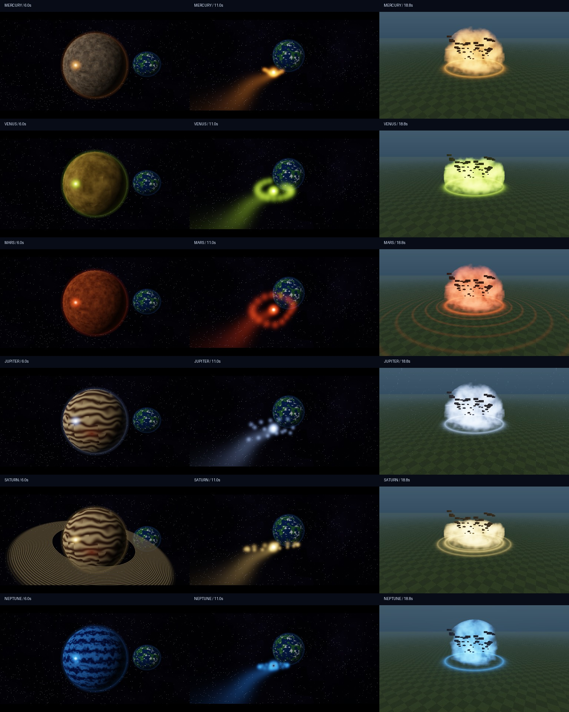

# Cosmic Cataclysm — первый прототип



Изображения выше отрисованы самим WGSL на RTX 5070 в синтетической сцене.
Это не скриншоты запущенного Minecraft/Horizon.

Самостоятельная сборка без установки cargo-horizon-mod:

```sh
rustup target add wasm32-unknown-unknown
python tools/build.py --standalone
```

SDK включён в vendor и закреплён на commit 50583ab5f816f21580a6102b7b1365a3667bb15a.

Мод для Horizon: пульт, шесть планет и космическая постановка перед ударом.
Обычные Fabric и Forge не подходят. Нужен форк
[Stink-O/horizon, ветка mod-api-input-ui-render-world](https://github.com/Stink-O/horizon/tree/mod-api-input-ui-render-world),
релиз `orbital-mod-api-11` или совместимый новее, с мод-интерфейсом API 0.2.
Ресурсы Minecraft подготавливаются из собственной копии игры по инструкции Horizon.

Это исходники первого прототипа. Он пока не был запущен и оценён в настоящей игре;
наличие файлов и успешная компиляция сами по себе не подтверждают качество графики,
плавность или совместимость с конкретным компьютером. Проверки, фактически проведённые
для поставки, перечисляются отдельно в `VALIDATION.md`, если этот файл присутствует.

## Что реализуется

- Пульт `cosmic:control`, меню шести планет, выбор атаки и переключатели.
- Mercury / Iron Rain, Venus / Acid Cyclone, Mars / Red Tempest,
  Jupiter / Thunder Colossus, Saturn / Ringfall, Neptune / Singularity Tide.
- Процедурная космическая сцена: подъём 0–3 с, планета и заряд 3–8 с,
  сопровождение снаряда 8–15 с, возврат 15–17 с, удар на 17-й секунде.
- Оригинальные шейдерные эффекты и обломки, собственные текстуры и синтезированные звуки.

Космический пролёт в этой версии — **виртуальная камера внутри шейдерной сцены**.
Она показывает сгенерированные планеты и Землю, затем возвращает изображение реального
мира перед ударом. Физическая камера и сам персонаж не отправляются через мир в космос.
Это не загрузка настоящего игрового мира на другой планете. Игрок во время сцены
остаётся на месте; пауза и прекращение сцены доступны обычным управлением.

Разрушения выключены по умолчанию. При их включении мод вырезает постоянную чашу
радиусом до 34 блоков и глубиной до 18 блоков; материал дна зависит от планеты.
Визуальные летящие обломки рисуются шейдером и не являются полноценными физическими
блоками, которые можно подобрать или которые затем строят новые сооружения.
`stop` останавливает будущую работу, но не возвращает уже изменённые блоки.
Первое включение разрушений делайте в отдельном испытательном мире.

## Сборка

Нужны Rust с поддержкой edition 2024, Python 3 и инструмент сборки из указанной ветки:

```sh
rustup target add wasm32-unknown-unknown
cargo install --git https://github.com/Stink-O/horizon --branch mod-api-input-ui-render-world cargo-horizon-mod
python tools/build.py
```

Для явного пути к инструменту:

```sh
python tools/build.py --cargo-horizon-mod /path/to/cargo-horizon-mod
```

Скрипт запускает сборку в `mod/`, берёт `mod.wasm` из созданного пакета и добавляет
ресурсы. Результат: папка `dist/cosmic/` и архив `dist/cosmic.hmod`.
Скрипт не устанавливает мод и не меняет сохранения игры.

Если компонент уже собран отдельно:

```sh
python tools/build.py --component /absolute/path/to/mod.wasm
```

Параметр принимает готовый компонент Horizon, а не произвольный wasm-модуль.
Скрипт проверяет заголовок WebAssembly; совместимость компонента с Horizon должна
быть подтверждена инструментом сборки и запуском.

Готовые ресурсы уже включены. Для их повторной генерации:

```sh
python -m pip install soundfile
python tools/make_assets.py
```

## Установка и управление

Закройте игру. Скопируйте папку `dist/cosmic` в `horizon-mods/cosmic` выбранной
инстанции совместимого форка. Включите мод в списке модов Horizon. Папка должна
содержать `horizon-mod.toml` и `mod.wasm` непосредственно внутри себя.

Откройте творческий мир и выполните `/cosmic control`. Возьмите пульт в руку,
нажмите **R**, выберите планету. Наведитесь на землю в 45–512 блоках и нажмите
правую кнопку мыши. **X** прекращает текущую сцену. **Esc** закрывает меню.

| Команда | Действие |
| --- | --- |
| `/cosmic control` | Выдать пульт |
| `/cosmic menu` | Открыть меню |
| `/cosmic planet mercury` | Выбрать Меркурий |
| `/cosmic planet venus` | Выбрать Венеру |
| `/cosmic planet mars` | Выбрать Марс |
| `/cosmic planet jupiter` | Выбрать Юпитер |
| `/cosmic planet saturn` | Выбрать Сатурн |
| `/cosmic planet neptune` | Выбрать Нептун |
| `/cosmic fire` | Запустить выбранную атаку по прицелу |
| `/cosmic stop` | Прервать сцену и оставшуюся очередь изменений |
| `/cosmic cinema on` / `off` | Включить или выключить космический пролёт |
| `/cosmic terrain on` / `off` | Разрешить или запретить изменения мира для следующих атак |
| `/cosmic quality full` / `fast` | Выбрать качество эффектов |

Текущий прототип рассчитан на одиночную игру. Сетевая синхронизация не реализована.
Для команд изменения мира нужны соответствующие разрешения. На дальности, где
игра не загрузила чанки, мир может не принимать изменения; текущая версия не обещает
заранее загрузить всю область. После включения настроек они сохраняются между запусками.

## Исходники

`mod/src/lib.rs` содержит предметный ввод, меню, расписание сцены и изменения блоков.
`mod/shaders/cosmic.wgsl` содержит оригинальную графику. Шейдер использует встроенную
в Horizon преамбулу постобработки: отдельно он не является готовым shader pack.
`tools/make_assets.py` генерирует оригинальную графику предметов и звуки.
