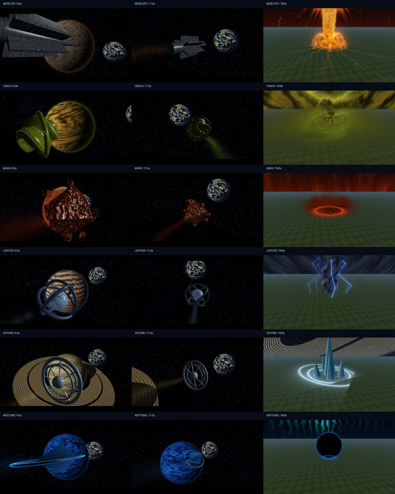
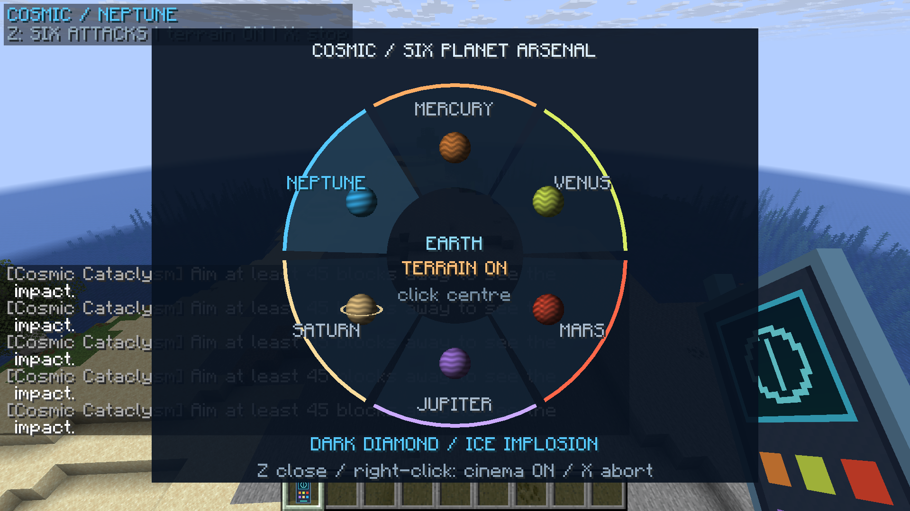
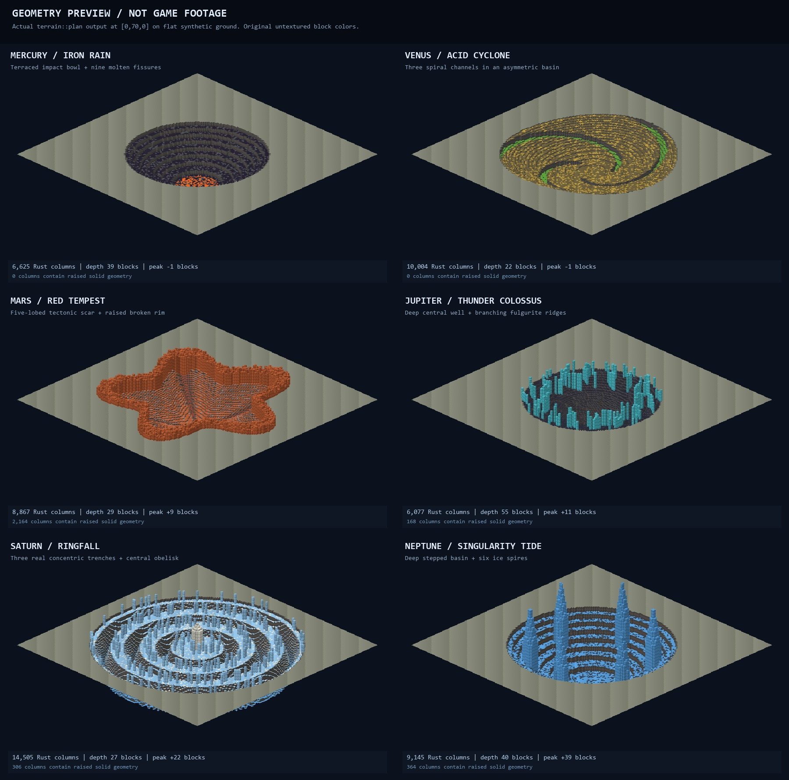

# Cosmic Cataclysm — экспериментальный мод для Horizon

Пульт управления шестью планетарными ударами: выбор планеты, космический пролёт,
сопровождение снаряда и возвращение к игроку перед взрывом.



Это отрисовка настоящего WGSL на RTX 5070 в синтетической сцене, не скриншоты игры.
Мод остаётся первым прототипом. Постановка и физика ещё требуют доработки.

Меню уже проверено в запущенном клиенте:



Разные формы оставляемой местности:



## Установка через лаунчер Horizon

В разделе добавления мода из GitHub вставьте:

```text
https://github.com/Egor-ship/cosmic-cataclysm
```

Используйте версию **0.2.0 или новее**. Лаунчер скачивает `cosmic.hnmod` из release.
В нём нативный Rust-код, предметы, текстуры и звуки. Пакет закреплён на Horizon
`e57b1d34bb0dcf6bf081c19fe6d2e7f69b60cdf4` и собирается самим лаунчером.
После установки включите мод, выполните нативную сборку в лаунчере и запустите игру.
Ручная установка: положить `cosmic.hnmod` в `horizon-native-mods` нужной инстанции.

В **0.1.0** был опубликован устаревший WebAssembly-пакет `.hmod`. Он не подходит
для современного лаунчера. В 0.1.1 добавлен нативный адаптер; специальный форк
Orbital для этой версии устанавливать не нужно.

## Управление

1. В творческом мире выполните `/cosmic control`.
2. Нажмите английскую **Z** — откроется колесо со всеми шестью планетами. Для открытия пульт держать не обязательно.
3. Наведитесь на землю в пределах 512 блоков и нажмите правую кнопку мыши.
4. **X** или `/cosmic stop` прерывает сцену.

Команды: `/cosmic menu`, `/cosmic planet mercury|venus|mars|jupiter|saturn|neptune`,
`/cosmic fire`, `/cosmic cinema on|off`, `/cosmic terrain on|off`,
`/cosmic quality full|fast`.

Каждая планета имеет собственный объёмный снаряд, траекторию камеры, небесное
явление, последовательность удара и форму реального кратера. Сцена длится 45 секунд;
удар происходит на 17-й. Состояние разрушений переключается центром колеса.

| Планета | Снаряд и небо | След в мире |
| --- | --- | --- |
| Меркурий | Металлическое копьё, затмение и солнечная корона | Ступенчатая чаша и расплавленные трещины |
| Венера | Спиральная оболочка, серный шторм | Спиральные канавы в широкой впадине |
| Марс | Раскалённый астероид, пылевые завесы и пояс обломков | Звездообразный разлом с поднятым краем |
| Юпитер | Гироскопический грозовой реактор, глаз циклона | Глубокий колодец с ветвями стекла |
| Сатурн | Кольцевой резак, ледяные кольца над миром | Три кольцевые траншеи и центральный выступ |
| Нептун | Гранёное ядро, сияния и гравитационная линза | Ступенчатая воронка с шестью ледяными шпилями |

Космическая камера виртуальная: шейдер рисует планеты и Землю, затем возвращает
изображение реального мира. Персонаж остаётся на месте. Камера держится за пределами
сфер планет и колец. Для шести траекторий проверены 19 806 позиций в WGSL на GPU.

Разрушения по умолчанию **включены**. В Overworld остаются реальные стилизованные
кратеры радиусом 44–68 блоков. Чтение высот и блоков выполняется перед сценой:
если область не загружена, мод просит подойти ближе и не запускает удар вслепую.
Отмена не возвращает уже изменённые блоки.

Обломки считываются из разрушаемой местности: четыре участка 5×5, глубина чтения
32 блока, до 256 настоящих блоков. Брёвна, листва и грунт используют текстуры и
биомные оттенки атласа игры; соседние блоки летят связанными фрагментами.
Это шейдерная отрисовка захваченных блоков, не физические entity. Целое дерево
может быть захвачено частично из-за размера участка и лимита. Нет физической укладки
обломков обратно. Нестандартные модели и дополнительные свойства block state
ограничены доступными данными Horizon; поддержаны стандартные кубические модели.

## Исходники и упаковка

`mod/src/lib.rs` и `mod/shaders/cosmic.wgsl` — основная логика и графика.
`mixins/cosmic` — нативный адаптер ввода, интерфейса, звука и рендеринга Horizon.
`horizon-native.json` и `mixins/cosmic/horizon-mixin.toml` — манифесты лаунчера.

```sh
python tools/build_native.py
```

Команда обновляет нативный движок и создаёт `dist/cosmic.hnmod`.
Сам клиент с модом компилирует лаунчер. Старые инструменты WebAssembly в
`tools/build.py` сохранены для прежнего форка и не нужны для установки 0.1.1.
В адаптере использованы MIT-исходники нативного Orbital Laser 0.5.10;
авторство и лицензии указаны в `NOTICE` и `THIRD_PARTY_LICENSES.md`.

Проведённые проверки перечислены в [VALIDATION.md](VALIDATION.md).
